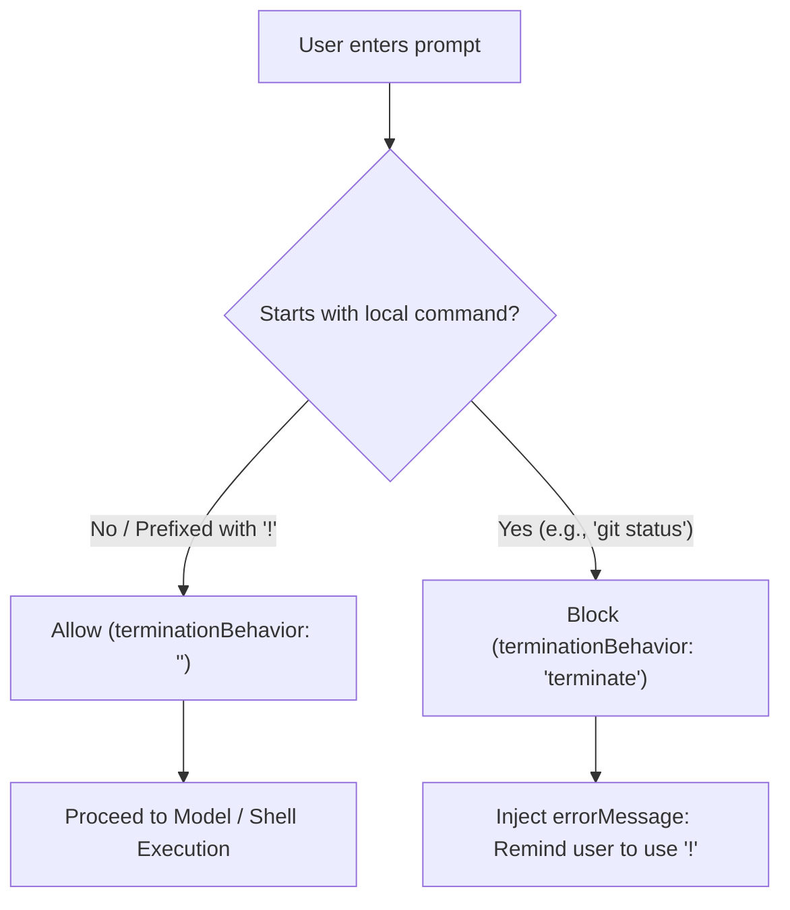

# 🛡️ Antigravity Bash Guard

[](https://opensource.org/licenses/MIT)
[](https://github.com/adublanche/antigravity-bash-guard/releases)
[](#requirements)
[](https://github.com/adublanche/antigravity-bash-guard)

A lightweight `PreInvocation` lifecycle guard for the **Google Antigravity CLI (`agy`)**. It prevents you from accidentally sending local shell commands (like `git status`, `ls -la`, or `docker ps`) as LLM conversational prompts when you forget to prepend them with an exclamation mark (`!`).

---

## 🎯 The Problem

In the Antigravity CLI, prepending commands with an exclamation mark (`!`) executes them directly in your local shell:

```bash
# Correct: Runs instantly in your local bash shell
!git status
!ls -la
```

However, muscle memory often leads developers to type raw terminal commands directly into the prompt:

```bash
# Mistake: Accidentally sent as an LLM prompt!
git status
```

Without a guard, this triggers a round-trip to the model, wasting time, tokens, and quota while returning a conversational explanation of git instead of executing the command.

---

## 💡 The Solution

**Antigravity Bash Guard** registers a `PreInvocation` lifecycle hook in `~/.gemini/config/hooks.json`. Before any prompt is sent to the LLM:

1. It inspects the prompt payload.
2. It detects common local shell commands (`ls`, `cd`, `pwd`, `grep`, `find`, `cat`, `npm`, `git`, `python`, `docker`, `agy`).
3. If detected, it blocks the invocation and reminds you to use the `!` prefix.
4. If it's a genuine query (or already prefixed with `!`), it allows execution to proceed normally.



---

## ⚡ Quick Start (One-Line Install)

Run the following command directly in your WSL or Linux terminal:

```bash
curl -fsSL https://raw.githubusercontent.com/adublanche/antigravity-bash-guard/main/install.sh | bash
```

---

## 📦 Manual Installation

If you prefer to install manually from source:

1. **Clone the repository:**
   ```bash
   git clone https://github.com/adublanche/antigravity-bash-guard.git
   cd antigravity-bash-guard
   ```

2. **Run the local installer:**
   ```bash
   bash install.sh
   ```

---

## ⚙️ How It Works & Configuration

The installer deploys `check_command.sh` to `~/.gemini/config/hooks/` and safely updates `~/.gemini/config/hooks.json`:

```json
{
  "bash-guard": {
    "PreInvocation": [
      {
        "type": "command",
        "command": "/home/YOUR_USER/.gemini/config/hooks/check_command.sh",
        "timeout": 15
      }
    ]
  }
}
```

### Monitored Commands

By default, the hook intercepts prompts starting with:
`ls`, `cd`, `pwd`, `grep`, `find`, `cat`, `npm`, `git`, `python`, `docker`, `agy`.

To customize the list of intercepted commands, edit `~/.gemini/config/hooks/check_command.sh` and update the `CMD_REGEX` variable:

```bash
CMD_REGEX="^[[:space:]]*(ls|cd|pwd|grep|find|cat|npm|git|python|docker|agy|kubectl|cargo)([[:space:]]|$)"
```

---

## 🗑️ Uninstallation

To remove Antigravity Bash Guard:

1. **Remove the script:**
   ```bash
   rm -f ~/.gemini/config/hooks/check_command.sh
   ```

2. **Remove the hook from `hooks.json`:**
   ```bash
   python3 -c "
   import json, os
   p = os.path.expanduser('~/.gemini/config/hooks.json')
   if os.path.exists(p):
       with open(p, 'r') as f: d = json.load(f)
       d.pop('bash-guard', None)
       with open(p, 'w') as f: json.dump(d, f, indent=2); f.write('\n')
       print('Hook removed successfully.')
   "
   ```

---

## 📋 Requirements

- Linux or Windows Subsystem for Linux (WSL) / macOS
- Bash 4+
- Python 3.6+ (for safe JSON handling)
- Antigravity CLI (`agy`)

---

## 🤝 Contributing

Contributions, feature suggestions, and pull requests are welcome!

1. Fork the Project
2. Create your Feature Branch (`git checkout -b feature/AmazingFeature`)
3. Commit your Changes (`git commit -m 'Add some AmazingFeature'`)
4. Push to the Branch (`git push origin feature/AmazingFeature`)
5. Open a Pull Request

---

## 📄 License

Distributed under the MIT License. See `LICENSE` for more information.
